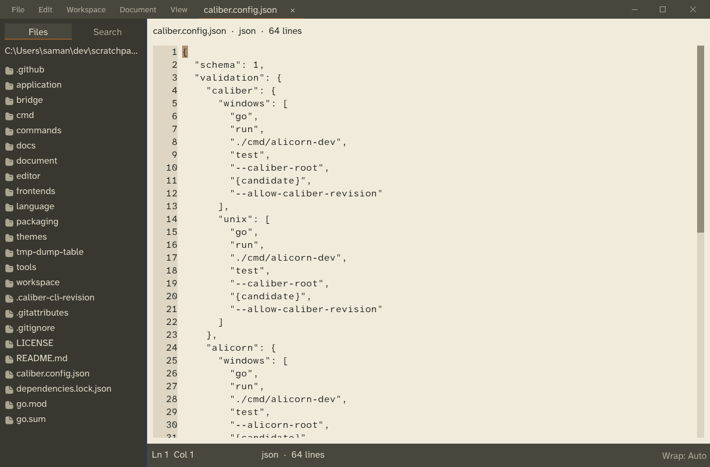
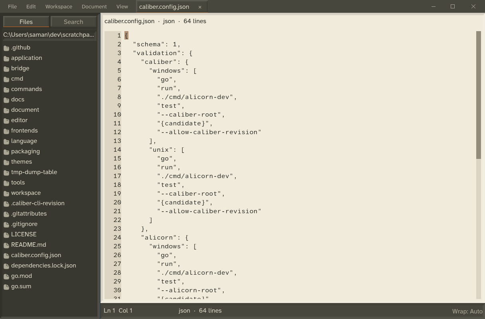
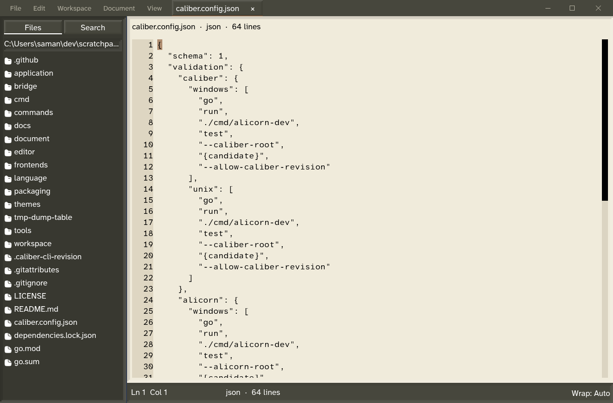

# Workbench Relief (experimental)

Select **Workbench Relief (Experimental)** in Settings → Appearance, View,
or the command palette. **Flat Workbench** uses the same Warm colors with flat
surfaces, providing a comparison. Warm and Cool Light keep their existing
appearances; Warm remains the default. The choice uses the existing atomic
version-1 preference file and is synchronized with detached documents.

The application names optical relationships without adding widget roles:

| Relationship | Optical height | Consumer |
| --- | --- | --- |
| Recessed | -1.75 | Editor and sidebar wells |
| Groove | -1 | Find/status/path insets and pressed control treatment |
| Flush | 0 | Ordinary structural chrome/status areas |
| Mounted | 1.5 | Default/Primary/Toolbar Buttons, tabs and filled Quiet rows |
| Floating | 2 | Settings, palettes and font picker |

Relief uses dedicated 2–3 unit bevels with stronger edge contrast. The original
experiment used almost imperceptible shading and left Tab/Quiet controls flat;
the main-workbench comparison now covers those visible controls explicitly.

The implementation uses Alicorn semantic surfaces, immutable material IDs and
typed Button recipes. Optical height never changes layout, interaction bounds,
semantic entities or window ordering. Font/text geometry is unaffected. The
JSON theme compiler still authors colors, lengths and material definitions;
the application connects typed setup-only Button material treatments to
Runtime-local handles. There is no new theme parser or paint callback.

## Reproduce the snapshots

Build the frontend against the matching Alicorn candidate, then run:

```powershell
.\tools\capture_workbench_relief.ps1 -Workbench
```

The tool opens the same real workspace and `caliber.config.json` document in
Flat, Relief and Increased Contrast + Reduced Transparency. Omit `-Workbench`
to capture the Editor Settings scene. `SCRATCHPAD_APPEARANCE_FIXTURE`
selects only in-memory fixture state; it does not save a preference. Session
and recovery persistence are disabled during these bounded smoke runs.
GPU readbacks, inspector output, counters and logs are written beneath
`out/workbench-relief`. The workspace fixture uses one diagnostic-only scheduled
wake to let document loading settle before capture; ordinary operation has no
new timer. Windows BGRA readbacks are converted to RGB by Alicorn so captures
preserve the actual warm theme colors.

Windows D3D12 evidence from 2026-10-23, at the desktop's 100% scale:





All three native smokes passed publication/wake/ordered shutdown. With identical
1216×799 captures, 24,012 pixels (2.47%) differ by at least 12 color levels
between Flat and Relief, concentrated on control edges and pane frames. The
interior text surface remains unshaded. These are appearance samples, not
golden-image compatibility promises.

162 frontend regressions and 13 bridge tests pass. A visibility regression
requires perceptible edge contrast for ordinary controls and unselected tabs,
rather than checking only that a nonzero material ID is present. Optical transitions in the
full editor/modal/tab fixture preserve semantic nodes and caret source position
without new measurement or layout. Settings interaction/geometry is tested at
100%, 125%, 150% and 200% text scale; native material budgets independently use
all four pixel scales. Actual fractional-DPI monitor moves, physical AT and
macOS desktop captures remain unverified. Keep Alicorn #98 open for those
acceptance gates; do not infer native macOS behavior from these Windows runs.
