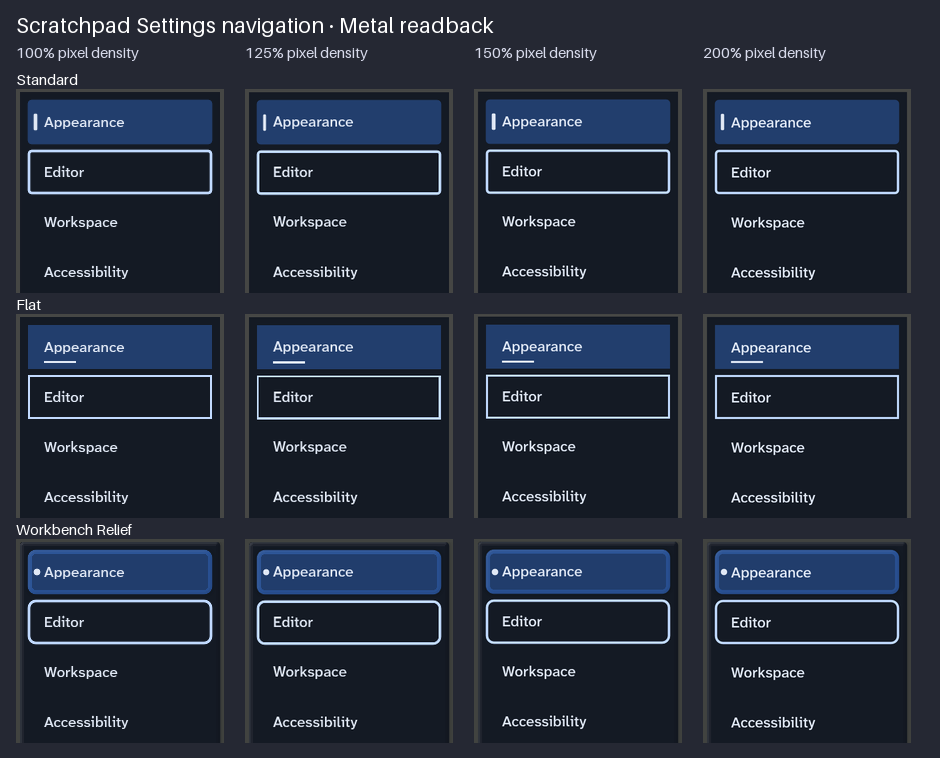

# Settings navigation style pilot

Scratchpad exercises Alicorn's typed properties and visual parts on the wide
Settings sidebar. The existing Surface treatment setting selects a bar
(Standard), an underline (Flat), or a dot and raised face (Workbench Relief).
All three use the same category Buttons, accessible names, focus outline, and
page switching. The surface treatment setting preserves each category's
logical target and label metrics. The study varies typography and target
height separately. Narrow Settings still uses its category dropdown.
[Alicorn #244](https://github.com/Carnival-Science/Alicorn/issues/244) ·
[#246](https://github.com/Carnival-Science/Alicorn/issues/246)

## DPI comparisons

The capture renders Scratchpad's actual Appearance page into Metal color
targets through SDL_GPU. Each scene uses a 1000 × 720 logical viewport at
100%, 125%, 150%, and 200% pixel density. The output sizes are 1000 × 720,
1250 × 900, 1500 × 1080, and 2000 × 1440. Appearance is selected and Editor
has the keyboard focus outline. Text scale stays at 100%. These are offscreen
readbacks of the retained paint list. The native title bar, OS compositor,
and retained backdrop filter are outside this capture path.



The crops use a common logical size for comparison. The bar, underline, dot,
and independent Editor focus outline are visible at all four densities.

## Work per change

Each sample starts from a fresh Runtime and settles description, scroll extent,
and focus before taking the first counter snapshot. It applies one change and
subtracts the before counters from the settled after counters. The local
edits touch the navigation style only. Preset uses Scratchpad's existing
Surface treatment setter with persistence disabled, so it includes other
optical changes on the Settings scene. The editor and file tree are outside
this fixture.

The counters count Runtime visits and requests, so they do not measure
wall-clock cost or GPU work. The headless probe prints one
`settings-style-work` line per change and scale. Columns are scale, change,
description passes, reconcile visits, layout visits, executed measurements,
shaping requests, paint visits, finalized display commands, persistent
allocation calls, and scratch allocation calls.

The counts matched at all four pixel densities. Each non-idle row includes one
description and 46 reconciliation visits.

| Change | Layout visits | Measurements | Shaping requests | Paint visits | Finalized commands | Persistent / scratch allocations |
| --- | ---: | ---: | ---: | ---: | ---: | ---: |
| Settled idle | 0 | 0 | 0 | 0 | 0 | 0 / 0 |
| Force the same description | 0 | 0 | 0 | 0 | 0 | 4 / 2 |
| Change the selected face fill | 0 | 0 | 0 | 3 | 40 | 15 / 2 |
| Increase four category labels by 2 logical units | 42 | 4 | 4 | 4 | 40 | 78 / 222 |
| Increase four category targets by 6 logical units | 42 | 8 | 0 | 21 | 40 | 156 / 60 |
| Change the selected face material | 0 | 0 | 0 | 1 | 40 | 9 / 2 |
| Switch Standard to Workbench Relief | 21 | 2 | 1 | 45 | 40 | 300 / 92 |

Fill also affects the focus and hover backgrounds under Reduce Transparency.
Fill and material edits avoid layout and text shaping. Their device-space
finalization still visited the scene's 40 commands. The height edit reached
Settings layout with reusable glyph runs. The full product preset changes
the theme and other surfaces in Settings.
[Counter data for all 28 samples](settings-navigation-styles/runtime-work.csv)

Each sample compares retained navigation commands with a fresh Runtime.
The comparison covers bounds, clipping, surface paint, text ink, and
resolved glyph placement. On the pinned runtime, changing the extent of a
positioned decoration at the same origin initially left the retained paint
bounds stale. A 44-to-50 logical-unit height change left the focus outline
at 44, and a bar-to-dot change kept the old 3 × 16 mark. The pilot keys the
outline by extent and the mark by shape so those decorations regenerate.
The category Button keys and named part contracts stay stable.

A Warm-to-Cool Light switch at 150% text scale covers selection, focus,
theme-resolved ink, Increased Contrast, Differentiate Without Color, and
Reduce Transparency together. Scratchpad's theme switch requests a
description. Same-ID paint-only theme replacement for values copied by
application code remains unverified.

These runs used Scratchpad main at `3a8b7e6` plus the pilot, locked Alicorn
`28cc7f92` (v0.2.3), Odin `dev-2026-11:9a6991685`, and macOS arm64 with
SDL 3.4.20. The native Scratchpad Settings smoke, Go tests, and bridge
checks passed. The Odin frontend reported 260 of 262 passing, including
the new work and accessibility probes and the existing Flat/Relief
semantic geometry comparison. The same two Settings scroll and intrinsic
layout tests failed on the unmodified base.

## Reproduce

Sync the dependencies as described in the repository README, then run
`./tools/alicorn.sh test` to collect the counter lines. For Metal readbacks,
build on macOS and give the executable an existing output directory:

```sh
./tools/alicorn.sh build --release
mkdir -p out/settings-style-captures
SCRATCHPAD_SETTINGS_STYLE_CAPTURE="$PWD/out/settings-style-captures" \
  ./out/alicorn/scratchpad-alicorn
```

The capture uses the main thread for SDL Cocoa initialization and exits
before loading preferences or opening the editor.
